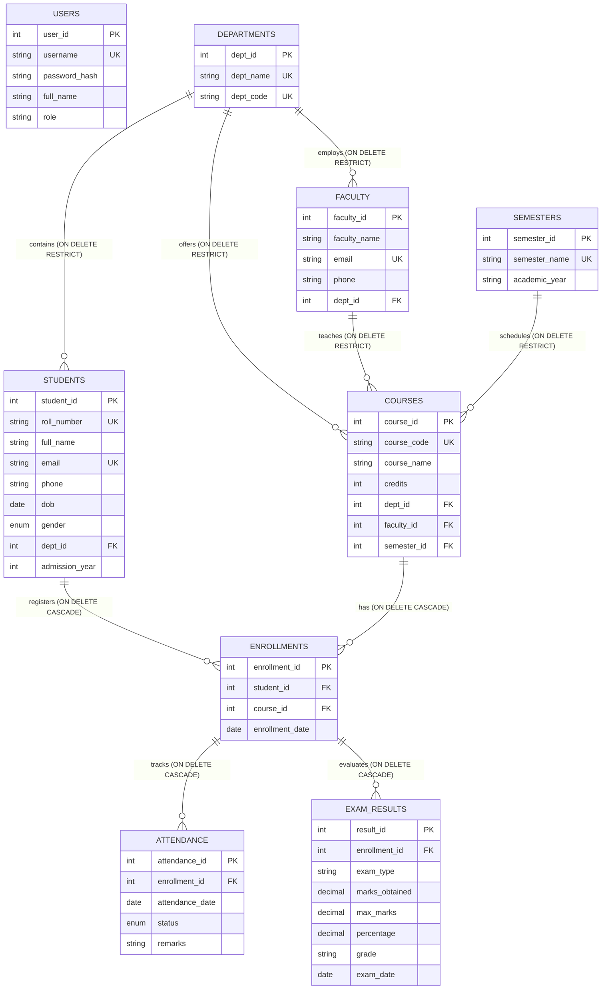

# DESIGN AND IMPLEMENTATION OF A DATABASE MANAGEMENT SYSTEM FOR STUDENT AND COLLEGE MANAGEMENT SYSTEM

**Academic Level:** 2nd Year B.Tech Computer Science & Engineering (DBMS PBL / Practical Assignment)  
**Architecture:** Full-Stack Relational Database Management System Web Application  
**Primary Database Engine:** MySQL 8  
**Backend Framework:** Python 3 + Flask  
**Frontend UI:** HTML5, CSS3, Vanilla JavaScript, Bootstrap 5 (Clean University Blue & White Design)  

---

## 📌 Project Problem Statement & Objectives

### Problem Statement
Traditional academic record keeping often relies on disparate physical registers or isolated flat files. This leads to data anomalies, duplicate course registrations, lost attendance marks, and human computation errors when calculating semester percentages and grade reports.

### Project Objectives
1. **Centralized Relational Storage:** Establish a centralized MySQL 8 relational database (`student_college_management`) normalized to Third Normal Form (3NF).
2. **Referential Integrity & Constraints:** Enforce Primary Keys, Foreign Keys, `UNIQUE` constraints (e.g., student course enrollments, attendance dates), and `CHECK` constraints on marks and credits.
3. **Prevent Unsafe Deletions:** Implement `ON DELETE RESTRICT` on core master entities (e.g., departments, faculty) so academic records cannot be accidentally orphaned.
4. **Intuitive Administrative Interface:** Provide a clean, distraction-free administration dashboard for adding, viewing, searching, updating, and deleting college data without manual SQL terminal queries.
5. **Accurate Computation:** Automatically compute student attendance percentages and standardized institutional letter grades (`A+`, `A`, `B`, `C`, `D`, `F`) directly based on database records.

---

## 🏗️ Technology Stack

| Component | Technology | Description |
|---|---|---|
| **Frontend** | HTML5, CSS3, JavaScript | Lightweight, semantic templates with responsive blue & white layout |
| **CSS Framework** | Bootstrap 5.3 + Bootstrap Icons | Clean cards, modals, form inputs, badges, and tables |
| **Backend** | Python 3 (Flask) | Lightweight WSGI web framework, session management, route decorators |
| **Database** | MySQL 8.0 | High-performance relational database engine (InnoDB storage engine) |
| **Connector** | `mysql-connector-python` | Official pure-Python database driver supporting parameterized queries |
| **Security** | `Werkzeug` | Secure scrypt/pbkdf2 password hashing for admin credentials |

---

## 🗂️ Project Directory Structure

```
hdbms pbl/
├── app.py                     # Main Flask web application and all route handlers
├── db.py                      # MySQL database helper (parameterized queries & connection pool)
├── config.py                  # Application settings & environment loader
├── setup_database.py          # Automated one-click database setup and seeding script
├── requirements.txt           # Python dependency requirements
├── .env.example               # Template environment configuration file
├── .gitignore                 # Git ignore rules for virtualenv and sensitive files
├── README.md                  # Comprehensive academic setup, ER diagram, and viva guide
├── database/
│   ├── schema.sql             # Complete 3NF MySQL table creation script (9 tables)
│   ├── seed.sql               # Realistic sample records (minimum 5 per table)
│   └── demo_queries.sql       # 12 essential SQL demonstration queries for viva
├── static/
│   ├── css/
│   │   └── style.css          # University blue-and-white theme stylesheet
│   └── js/
│       └── main.js            # Client-side calculations and UI confirmation helpers
├── templates/
│   ├── base.html              # Base layout with responsive sidebar and header
│   ├── login.html             # Admin authentication portal
│   ├── dashboard.html         # Dashboard overview with 4 SQL COUNT cards
│   ├── students.html          # Student list with search and CRUD
│   ├── student_form.html      # Student Add/Edit form
│   ├── faculty.html           # Faculty list with search and CRUD
│   ├── faculty_form.html      # Faculty Add/Edit form
│   ├── departments.html       # Department list with student and faculty counts
│   ├── department_form.html   # Department Add/Edit form
│   ├── courses.html           # Course management table with joins
│   ├── course_form.html       # Course Add/Edit form
│   ├── enrollments.html       # Student course registration management
│   ├── attendance.html        # Daily attendance marking and % calculations
│   ├── exam_results.html      # Examination marks recording and grading scale
│   └── exam_result_form.html  # Examination result edit form
└── tests/
    └── test_system.py         # Automated test suite (routing, grading, hashing, SQL)
```

---

## 📊 Relational Database Schema & 3NF Normalization

The database consists of **9 normalized tables**:



### Normalization Breakdown (1NF, 2NF, 3NF)

1. **First Normal Form (1NF):**
   - Every column contains atomic (indivisible) values (e.g., student name and contact details are stored in single discrete cells, not comma-separated lists).
   - Every table has a clearly designated Primary Key (`AUTO_INCREMENT`).
   - No repeating groups or variable-length arrays exist.

2. **Second Normal Form (2NF):**
   - The tables satisfy 1NF.
   - All non-key attributes are fully functionally dependent on the entire Primary Key.
   - For example, course details (`credits`, `dept_id`, `faculty_id`) depend solely on `course_id` and are separated into `courses`, rather than repeated inside each student enrollment row.

3. **Third Normal Form (3NF):**
   - The tables satisfy 2NF.
   - There are **no transitive dependencies** ($X \rightarrow Y$ and $Y \rightarrow Z$).
   - For example, `students` stores only foreign key `dept_id`, not department names or department codes. If a department's name changes, only the `departments` table is updated in a single place.
   - Similarly, `attendance` and `exam_results` link to `enrollment_id`. They do not store redundant copies of student names, course titles, or faculty IDs, completely preventing update, insertion, and deletion anomalies.

---

## 💻 Step-by-Step Windows Setup Guide

### Step 1: Install Python and MySQL
1. **Python 3 (3.10 or higher):** Download from [python.org](https://www.python.org/downloads/). During installation, check the box: **"Add Python to PATH"**.
2. **MySQL 8.0 Community Server & Workbench:** Download from [dev.mysql.com](https://dev.mysql.com/downloads/installer/). Remember the password you set for the `root` user during setup. Ensure the Windows service `MySQL80` is running.

### Step 2: Open Project Folder in Windows Terminal / VS Code
Open PowerShell or Command Prompt and navigate to the project directory:
```powershell
cd "c:\Users\andre\OneDrive\Documents\Desktop\hdbms pbl"
```

### Step 3: Create & Activate Python Virtual Environment
```powershell
python -m venv venv
.\venv\Scripts\Activate.ps1
```
*(If PowerShell shows an execution policy warning, run: `Set-ExecutionPolicy -Scope Process -ExecutionPolicy Bypass`)*

### Step 4: Install Dependencies
```powershell
pip install -r requirements.txt
```

### Step 5: Configure `.env` File
Create a `.env` file in the project folder (or copy from `.env.example`):
```powershell
copy .env.example .env
```
Open `.env` in Notepad or VS Code and set your MySQL password:
```ini
DB_HOST=localhost
DB_PORT=3306
DB_NAME=student_college_management
DB_USER=root
DB_PASSWORD=your_actual_mysql_password
SECRET_KEY=btech_college_mgmt_secret_key
FLASK_DEBUG=True
```

### Step 6: Initialize and Seed the MySQL Database
You have **two easy options**:

#### Option A: One-Click Python Setup (Recommended)
Run the included setup script:
```powershell
python setup_database.py
```
*(If your password is not in `.env` yet, pass it directly: `python setup_database.py --password your_password`)*

#### Option B: Using MySQL Workbench
1. Launch **MySQL Workbench** and connect to your local instance.
2. Click **File -> Open SQL Script...** and select `database/schema.sql`.
3. Click the **Execute (Lightning bolt)** icon to create the database and tables.
4. Next, open `database/seed.sql` and execute it to load sample data.

### Step 7: Run the Flask Web Application
```powershell
python app.py
```

Open your web browser and navigate to:
👉 **`http://127.0.0.1:5000`**

### Step 8: Log In
- **Username:** `admin`
- **Password:** `admin123`

---

## 🎯 How to Demonstrate the Project for Viva / Practical Exam

Follow this structured demonstration script during your DBMS presentation:

### 1. Authentication & Security Demonstration
- Navigate to `http://127.0.0.1:5000/`.
- Show that attempting to access `/dashboard` or `/students` without logging in immediately redirects to `/login`.
- Log in with `admin` and `admin123`. Explain that passwords are stored as cryptographic hashes (`scrypt`/`pbkdf2`) in MySQL, never plaintext.

### 2. Dashboard SQL Aggregations
- Show the 4 summary cards: **Total Students**, **Total Faculty**, **Total Departments**, **Total Courses**.
- Point out that each card executes an optimized SQL query: `SELECT COUNT(*) FROM table`.
- Point out the **Recently Added Students** table which performs an `INNER JOIN` between `students` and `departments`.

### 3. Student Management (Full CRUD + Search)
- **Search:** In the search bar on the Students page, type a student name or roll number (e.g., `Aarav`) to demonstrate real-time server-side `LIKE` filtering.
- **Insert:** Click **Add New Student**, fill in all details, and click **Save Student Record**. Verify the new row appears.
- **Update:** Click the **Edit (Pencil)** icon, modify the phone number or admission year, and save.
- **Delete:** Create a safe test student (`TEST01`), then click the **Delete (Trash)** icon. Show the confirmation modal and subsequent safe deletion.

### 4. Referential Integrity & Foreign Key Safeguards
- Go to the **Departments** page.
- Try to delete the `Computer Science & Engineering` department.
- Point out the alert: **MySQL Foreign Key RESTRICT constraint prevented deletion** because students and faculty are actively enrolled in CSE! Explain how this protects relational integrity.

### 5. Student Course Enrollment & Duplicate Prevention
- Go to the **Student Enrollments** page.
- Select a student and enroll them in a course.
- Try to enroll the **exact same student in the exact same course again**.
- Show the error alert: **`uk_student_course UNIQUE (student_id, course_id)` prevented duplicate registration!**

### 6. Attendance Management & Formula Calculation
- Go to the **Attendance** page.
- Show the live **Attendance Percentage Summary** computed with the SQL formula:
  $$\text{Attendance \%} = \left(\frac{\text{Present Sessions}}{\text{Total Sessions}}\right) \times 100$$
- Point out that students below 75% display a red **Shortage** warning tag.
- Demonstrate the **Toggle** button to correct an attendance entry between Present and Absent.

### 7. Examination Results & Grading Scale
- Go to the **Examination Results** page.
- Enter marks obtained (e.g., 47) and maximum marks (50).
- Show the live client-side preview computing **94.00%** and assigning **Grade A+**.
- Submit the result and show it recorded in MySQL.

---

## 📝 Top 12 SQL Queries for Practical Exam / Viva

These queries are available in `database/demo_queries.sql` and can be run directly in MySQL Workbench:

1. **SELECT All Students:**
   ```sql
   SELECT student_id, roll_number, full_name, email, gender, admission_year FROM students;
   ```
2. **INSERT Example:**
   ```sql
   INSERT INTO students (roll_number, full_name, email, phone, dob, gender, dept_id, admission_year)
   VALUES ('23CSE999', 'Viva Test Student', 'viva.test@college.edu', '9999999999', '2004-01-01', 'Male', 1, 2024);
   ```
3. **UPDATE Example:**
   ```sql
   UPDATE students SET email = 'updated.viva@college.edu' WHERE roll_number = '23CSE999';
   ```
4. **Safe DELETE Example:**
   ```sql
   DELETE FROM students WHERE roll_number = '23CSE999';
   ```
5. **INNER JOIN (Students with Departments):**
   ```sql
   SELECT s.roll_number, s.full_name, d.dept_name, d.dept_code
   FROM students s
   INNER JOIN departments d ON s.dept_id = d.dept_id
   ORDER BY s.roll_number ASC;
   ```
6. **MULTI-TABLE JOIN (Students, Courses, Faculty, and Semesters):**
   ```sql
   SELECT s.roll_number, s.full_name AS student_name, c.course_code, c.course_name, f.faculty_name, sem.semester_name
   FROM enrollments e
   INNER JOIN students s ON e.student_id = s.student_id
   INNER JOIN courses c ON e.course_id = c.course_id
   INNER JOIN faculty f ON c.faculty_id = f.faculty_id
   INNER JOIN semesters sem ON c.semester_id = sem.semester_id;
   ```
7. **GROUP BY & COUNT (Department-wise Student Count):**
   ```sql
   SELECT d.dept_code, d.dept_name, COUNT(s.student_id) AS student_count
   FROM departments d
   LEFT JOIN students s ON d.dept_id = s.dept_id
   GROUP BY d.dept_id, d.dept_code, d.dept_name;
   ```
8. **GROUP BY & AVG (Average Marks by Course):**
   ```sql
   SELECT c.course_code, c.course_name, ROUND(AVG(r.marks_obtained), 2) AS avg_marks, ROUND(AVG(r.percentage), 2) AS avg_pct
   FROM courses c
   INNER JOIN enrollments e ON c.course_id = e.course_id
   INNER JOIN exam_results r ON e.enrollment_id = r.enrollment_id
   GROUP BY c.course_id, c.course_code, c.course_name;
   ```
9. **ATTENDANCE PERCENTAGE PER STUDENT:**
   ```sql
   SELECT s.roll_number, s.full_name, c.course_code,
          COUNT(a.attendance_id) AS total_sessions,
          SUM(CASE WHEN a.status = 'Present' THEN 1 ELSE 0 END) AS present_sessions,
          ROUND((SUM(CASE WHEN a.status = 'Present' THEN 1 ELSE 0 END) / COUNT(a.attendance_id)) * 100, 2) AS attendance_pct
   FROM enrollments e
   INNER JOIN students s ON e.student_id = s.student_id
   INNER JOIN courses c ON e.course_id = c.course_id
   LEFT JOIN attendance a ON e.enrollment_id = a.enrollment_id
   GROUP BY e.enrollment_id, s.roll_number, s.full_name, c.course_code;
   ```
10. **ORDER BY (Alphabetical Student Directory):**
    ```sql
    SELECT full_name, roll_number, email FROM students ORDER BY full_name ASC;
    ```
11. **WHERE Filtering (Filter Students by Department Code):**
    ```sql
    SELECT s.roll_number, s.full_name, d.dept_code
    FROM students s
    INNER JOIN departments d ON s.dept_id = d.dept_id
    WHERE d.dept_code = 'CSE';
    ```
12. **Metadata Query (Inspect Foreign Keys and Relational Constraints):**
    ```sql
    SELECT TABLE_NAME, COLUMN_NAME, CONSTRAINT_NAME, REFERENCED_TABLE_NAME, REFERENCED_COLUMN_NAME
    FROM information_schema.KEY_COLUMN_USAGE
    WHERE TABLE_SCHEMA = 'student_college_management' AND REFERENCED_TABLE_NAME IS NOT NULL;
    ```

---

## 🧪 Automated Testing

To run the automated test suite verifying route status codes, grading logic, cryptographic password verification, and database file integrity:

```powershell
python -m pytest tests/test_system.py
```

Expected result:
```
======================== 5 passed in 0.77s ========================
```

---

## 🎓 Academic Conclusion

This project successfully fulfills all curriculum requirements for a Second-Year B.Tech Database Management Systems practical project:
- Replaced paper/spreadsheet record keeping with a relational MySQL database.
- Adhered strictly to Third Normal Form (3NF) principles to eliminate insertion, deletion, and update anomalies.
- Protected user security with hashed credentials and parameterized queries to thwart SQL injection.
- Delivered a clean, intuitive, university-grade web interface ready for faculty review and viva presentation.
